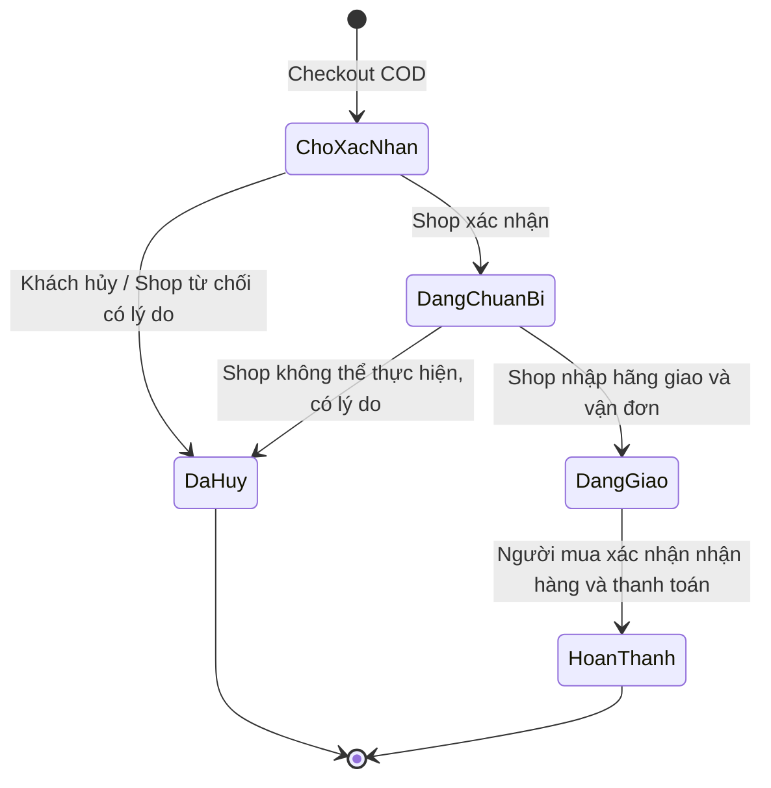
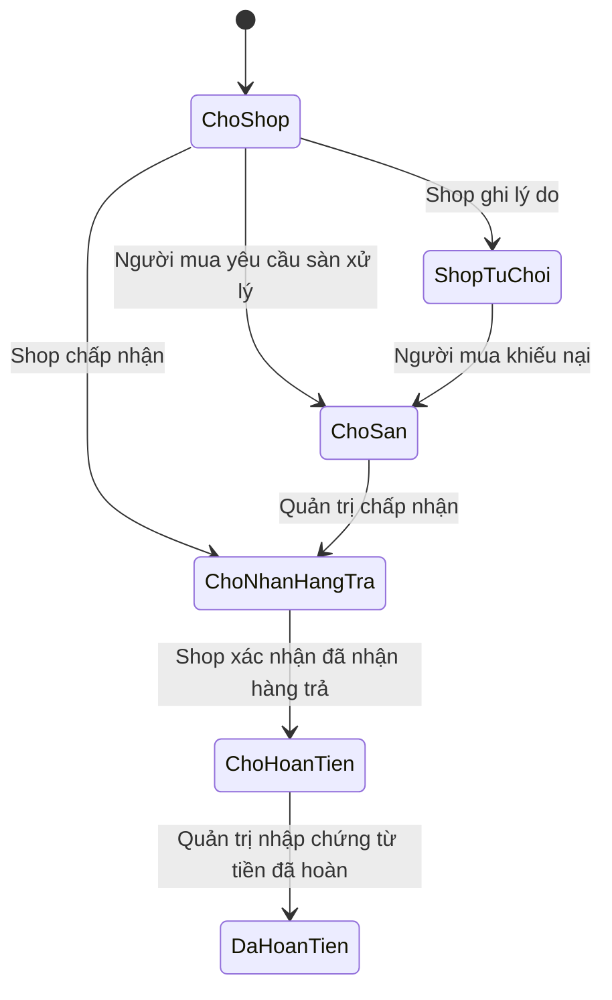
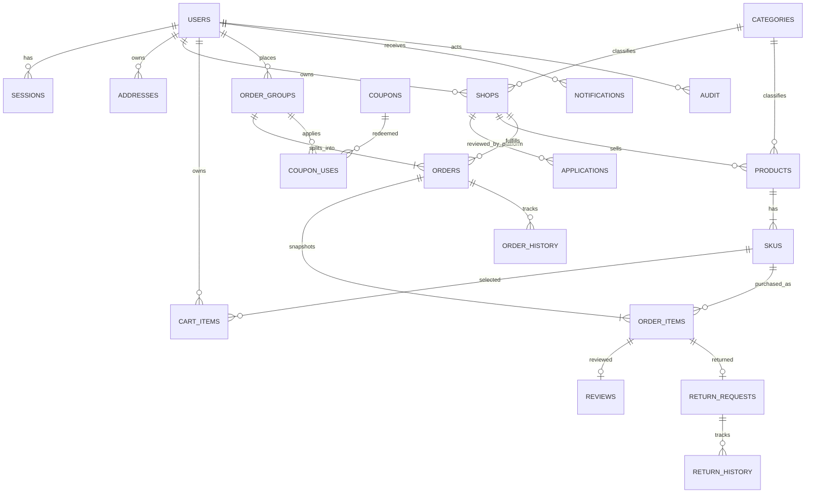
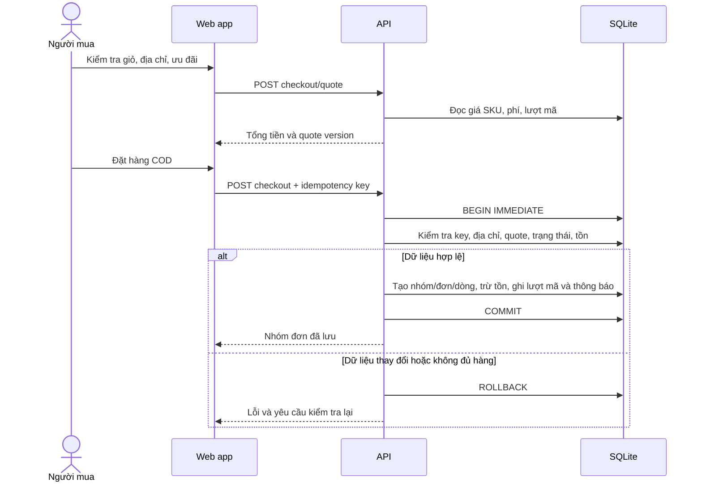

# Chợ PTIT — đặc tả web app

## Phạm vi hiện thực

Sàn nhiều gian hàng, nhiều ngành hàng; một tài khoản người bán đồng thời có thể mua sản phẩm của gian hàng khác. Đồng tiền VND, giá trị tiền lưu bằng số nguyên. Thanh toán COD; người bán nhập đơn vị vận chuyển và mã vận đơn. Người mua xác nhận đã nhận hàng và thanh toán. Sàn không gửi lệnh thu/chuyển tiền đến ngân hàng hoặc tự nhận sự kiện từ hãng vận chuyển.

Một tài khoản có thể sở hữu nhiều gian hàng. Quản trị được tạo bởi công cụ quản trị cục bộ, không thể tự đăng ký quyền admin trên website. Người dùng mới là người mua; hồ sơ gian hàng được duyệt mới có quyền bán.

## Ma trận quyền

| Tác vụ | Khách | Người mua | Người bán | Quản trị |
|---|---|---|---|---|
| Xem/tìm sản phẩm công khai | Có | Có | Có | Có |
| Hồ sơ, địa chỉ, giỏ, đơn mua | Không | Của mình | Của mình | Của mình |
| Đăng ký gian hàng | Không | Có | Có | Có |
| Sản phẩm và kho | Không | Không | Shop sở hữu đang hoạt động | Kiểm duyệt |
| Xác nhận/gửi đơn | Không | Không | Đơn thuộc shop sở hữu | Xem toàn sàn |
| Xác nhận nhận hàng | Không | Đơn của mình | Đơn mình mua ở shop khác | Đơn của mình |
| Đánh giá | Không | Dòng hàng mình đã nhận | Dòng hàng mình đã nhận | Dòng hàng mình đã nhận |
| Trả hàng | Không | Yêu cầu của mình | Xử lý yêu cầu thuộc shop | Xử lý tranh chấp/ghi chứng từ hoàn |
| Ưu đãi, ngành hàng, khóa shop | Không | Không | Không | Có |
| Báo cáo | Không | Giao dịch của mình | Dữ liệu shop sở hữu | Toàn sàn |

API kiểm tra quyền trên mỗi request, kể cả khi thay ID hoặc sửa dữ liệu client. Người bán không được mua sản phẩm thuộc shop của chính mình. Shop bị khóa không nhận giao dịch bán mới; đơn đã phát sinh vẫn được xử lý.

## Use case và điều kiện chính

| Mã | Luồng | Kết quả / điều kiện |
|---|---|---|
| UC01 | Đăng ký → đăng nhập → cập nhật hồ sơ/địa chỉ | Cookie phiên và dữ liệu theo tài khoản |
| UC02 | Gửi/bổ sung hồ sơ shop → admin xét duyệt | Có lý do và nhật ký; không tự nâng quyền |
| UC03 | Tạo/sửa sản phẩm và SKU → admin duyệt | Giá/tồn mỗi SKU; nội dung chưa duyệt không công khai |
| UC04 | Tìm/lọc/phân trang → chọn SKU → thêm giỏ | Đúng giá, đúng tồn, giỏ lưu database |
| UC05 | Xem giá thanh toán → đặt COD nhiều shop | Một nhóm đặt hàng, đơn con và snapshot bất biến |
| UC06 | Shop chuẩn bị → nhập vận đơn → khách nhận | Lịch sử trạng thái, thông báo và báo cáo cập nhật |
| UC07 | Hủy trước xác nhận / shop không thể thực hiện | Hoàn đúng tồn một lần và giải phóng lượt ưu đãi phù hợp |
| UC08 | Đánh giá từ đơn hoàn thành | Một đánh giá mỗi dòng mua, không nhận đánh giá của người khác |
| UC09 | Yêu cầu trả → shop nhận hàng trả → admin ghi chứng từ hoàn | Không tự động chuyển tiền; không nhập kho/ghi hoàn lặp |
| UC10 | Khóa/mở shop, quản lý ngành hàng/ưu đãi và audit | Thay đổi có kiểm tra phạm vi và nhật ký |

## Quy tắc giỏ và đặt hàng

1. Giỏ tối đa 100 phân loại, mỗi phân loại từ 1 đến 99 sản phẩm. Giỏ gắn tài khoản và không lấy giá/tồn từ localStorage.
2. Server kiểm tra lại SKU, trạng thái duyệt/bán, trạng thái shop và tồn ngay khi đặt.
3. Giá thanh toán có fingerprint của giá/phí/ưu đãi. Khi các giá trị thay đổi, yêu cầu bị từ chối để người mua xem và xác nhận lại.
4. Checkout dùng transaction `BEGIN IMMEDIATE`; trừ tồn với điều kiện `stock >= qty`. Thất bại ở một shop làm rollback cả nhóm đơn.
5. Người mua gửi idempotency key; lặp cùng yêu cầu trả lại cùng nhóm đơn. Tái sử dụng key cho nội dung khác trả 409.
6. Địa chỉ, tên sản phẩm, phân loại, mã SKU, giá và giảm giá được chụp vào đơn. Sửa dữ liệu gốc không làm thay đổi giao dịch cũ.
7. COD trừ tồn khi tạo đơn. Chưa có giữ tồn chờ thanh toán online hoặc tác vụ hết hạn vì chưa hỗ trợ thanh toán trước.

## Tiền và ưu đãi

- Tiền hàng = tổng giá SKU × số lượng. Phí vận chuyển lấy từ shop tại thời điểm đặt và lưu snapshot.
- Áp dụng mã shop trước, mã sàn sau. Mức giảm không vượt tiền hàng còn lại. Mỗi mã có hạn dùng, tiền tối thiểu, số lượt và trạng thái bật/tắt.
- Phân bổ giảm giá theo trọng số từng dòng hàng; dùng BigInt khi nhân/chia và phân phối phần dư. Tổng phân bổ luôn bằng tổng giảm đến từng VND.
- Lượt sử dụng chỉ ghi trong transaction tạo đơn thành công. Hủy toàn bộ đơn thuộc phạm vi mã mới trả lượt; hủy một shop không tính lại ưu đãi của các đơn con còn lại.
- Hoàn tiền theo số tiền dòng đã mua sau ưu đãi, không gồm phí giao hàng. Báo cáo tách tiền đã thu, phí giao hàng và khoản hoàn có chứng từ.
- Ngày hiệu lực ưu đãi tính theo Asia/Bangkok (UTC+7); timestamp lưu UTC và hiển thị UTC+7.

## Trạng thái đơn hàng

Giao hàng, thanh toán và hoàn tiền có thông tin riêng. Người bán không thể tự đánh dấu người mua đã trả COD. Ghi nhận COD là xác nhận trong web app, chưa được đối chiếu tự động với hệ thống hãng vận chuyển.

## Trả hàng

Yêu cầu trong 7 ngày từ khi nhận hàng. Mỗi dòng hàng chỉ có một yêu cầu, áp dụng toàn bộ số lượng của dòng; chưa hỗ trợ tách nhiều đợt trả trên cùng một dòng. Người mua mô tả lỗi, shop có thể chấp nhận hoặc từ chối kèm lý do; người mua được gửi tranh chấp lên sàn.

Shop chỉ nhập lại tồn nếu đánh dấu hàng đã kiểm tra, đủ điều kiện bán. Admin ghi nhận hoàn tiền sau khi có chứng từ; thao tác này không phải lệnh chuyển tiền. Lịch sử phản hồi được lưu riêng với nhật ký kỹ thuật.

## ERD rút gọn

## Từ điển dữ liệu chính

| Bảng | Dữ liệu / ràng buộc quan trọng |
|---|---|
| users, sessions | Email duy nhất; password hash; role; token phiên lưu hash, TTL, CSRF |
| addresses | Thuộc user; tối đa một mặc định; snapshot riêng khi đặt |
| shops, applications | Chủ sở hữu, trạng thái, phí giao, thông tin hồ sơ và lý do xét duyệt |
| products, skus | Duyệt và hiển thị tách biệt; SKU duy nhất, giá/tồn nguyên không âm; version chống ghi đè |
| cart_items | Khóa ghép user/SKU, số lượng 1–99 |
| order_groups | Khóa duy nhất user/idempotency key, request hash, tổng tiền |
| orders | Shop, người mua, địa chỉ, trạng thái, COD, vận đơn, tổng tiền snapshot |
| order_items | Giá, số lượng và ưu đãi snapshot, liên kết SKU và sản phẩm |
| coupons, coupon_uses | Phạm vi, mức giảm, điều kiện, thời hạn, tổng lượt; chống dùng quá hạn mức |
| reviews | Duy nhất theo dòng mua, điểm 1–5, nội dung |
| return_requests, return_history | Tiền hàng được hoàn, trạng thái, nhập kho, chứng từ và lịch sử |
| favorites, notifications | Theo tài khoản, trạng thái đã đọc và đường dẫn giao dịch |
| audit | Tài khoản, hành động, đối tượng, chi tiết, thời gian |

## Trình tự checkout

